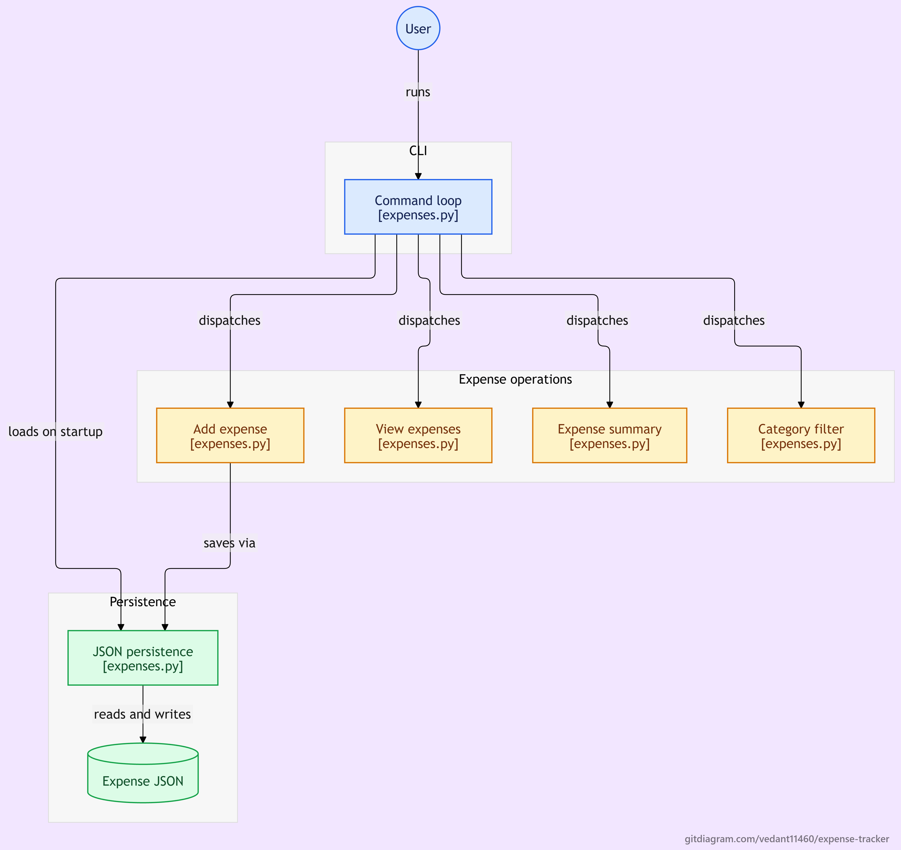

# Expense Tracker CLI

A simple command-line expense tracker written in Python. It records the date, category and amount of each expense, shows a summary per category, and lets you filter expenses by category.

## Features
- Add expenses with amount, category and today's date
- View all expenses
- Summary: total spent and total per category
- Filter expenses by category
- Input validation (rejects text, zero, negative amounts, empty categories)
- Data saved to a JSON file between runs

## How to run
    python expenses.py

## Workflow

